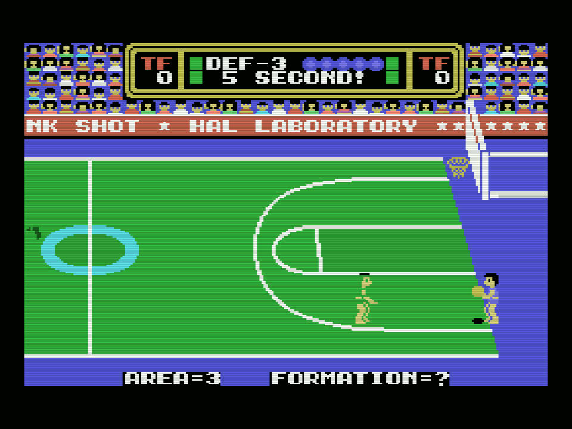
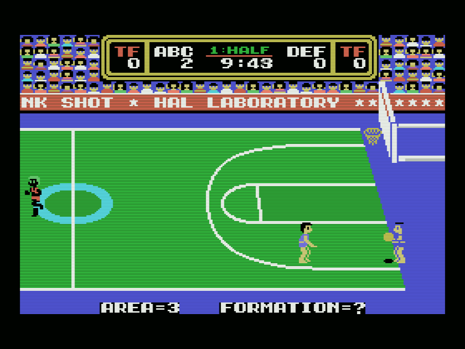
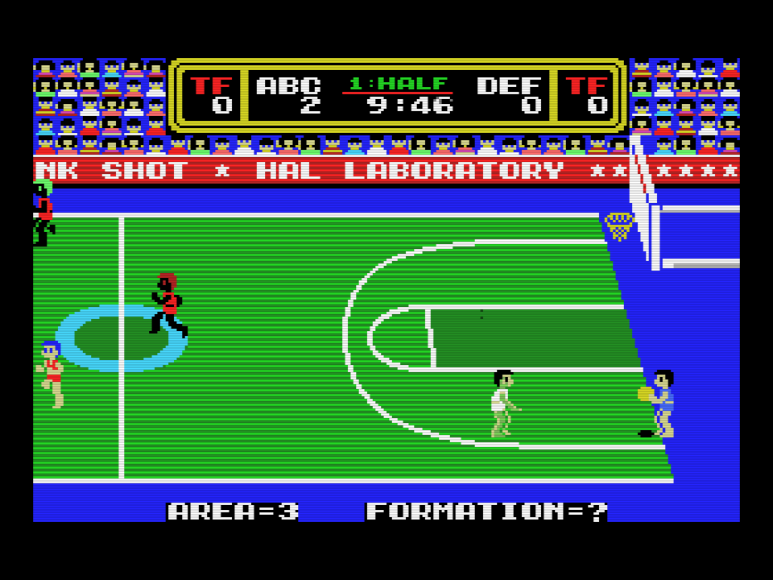

# In the emulator

Everything on this site was measured in openMSX: the original cartridge on an
MSX1, the patched one on an MSX1 and the patched one on a real MSX2, the
Philips NMS 8250. Nobody has run the patch on real hardware yet.

## The probe

`tools/omsx_parpadeo.tcl` reads, every frame, the attribute table the VDP is
showing (register 5, and register 0 to know which sprite mode is on) and
counts, line by line, how many sprites fall on each one. Those above the VDP's
limit, four on the TMS9918 and eight on the V9938 in sprite mode 2, are the
ones that are not drawn. It adds them up per frame and, at the end, dumps the
VRAM, the VDP registers and a screenshot. `tools/lanza_parpadeo.sh` launches
it:

    sh tools/lanza_parpadeo.sh <dir> <machine> <rom> <limit> <from> <to> "<keys>"

The keys go as `second row mask` of the keyboard matrix: space is row 8 with
0x01, down is row 8 with 0x40. Space three times goes from the title to the
menu, to SET-UP and to the match, with the computer playing both sides. The
MSX2 boots later, hence the later keys. With `DS_THROTTLE=on` it runs at real
speed, to watch it.

## The numbers

Thirty seconds of a match. No two matches are the same, so each run is a
different match.

| cartridge | machine | frames | sprites not drawn, per frame | worst frame |
|---|---|---|---|---|
| original | C-BIOS_MSX1_JP (MSX1, 60 Hz) | 1,798 | 66.7 | 166 |
| patched | C-BIOS_MSX1_JP (MSX1, 60 Hz) | 1,798 | 69.5 | 175 |
| patched | Philips_NMS_8250 (MSX2, 50 Hz) | 1,505 | 1.7 | 22 |

    sh tools/lanza_parpadeo.sh work/p_msx1_antes C-BIOS_MSX1_JP dunkshot.rom 4 16 46 "4 8 0x01 7 8 0x01 10 8 0x01"
    sh tools/lanza_parpadeo.sh work/p_msx1_d4 C-BIOS_MSX1_JP work/dunkshot_msx2.rom 4 16 46 "4 8 0x01 7 8 0x01 10 8 0x01"
    sh tools/lanza_parpadeo.sh work/p_msx2_d4 Philips_NMS_8250 work/dunkshot_msx2.rom 8 20 50 "8 8 0x01 11 8 0x01 14 8 0x01"

On the MSX1 the patched cartridge behaves like the original: register 5
alternates 0x7C and 0x7E, 899 frames each, and the count is that of a
different match, not of a worse game. On the MSX2, register 0 is 0x04 and
register 5 is 0x7F in all 1,505 frames.

## The screenshots

Each one is the last frame of a run above, as openMSX draws it.

The TRADE screen, with the sample figure, was taken at real speed and with the
window visible:

    DS_THROTTLE=on sh tools/lanza_parpadeo.sh work/p_msx2_trade_v Philips_NMS_8250 work/dunkshot_msx2.rom 8 20 21 "8 8 0x01 11 8 0x40 12 8 0x40 13 8 0x40 14 8 0x01"
