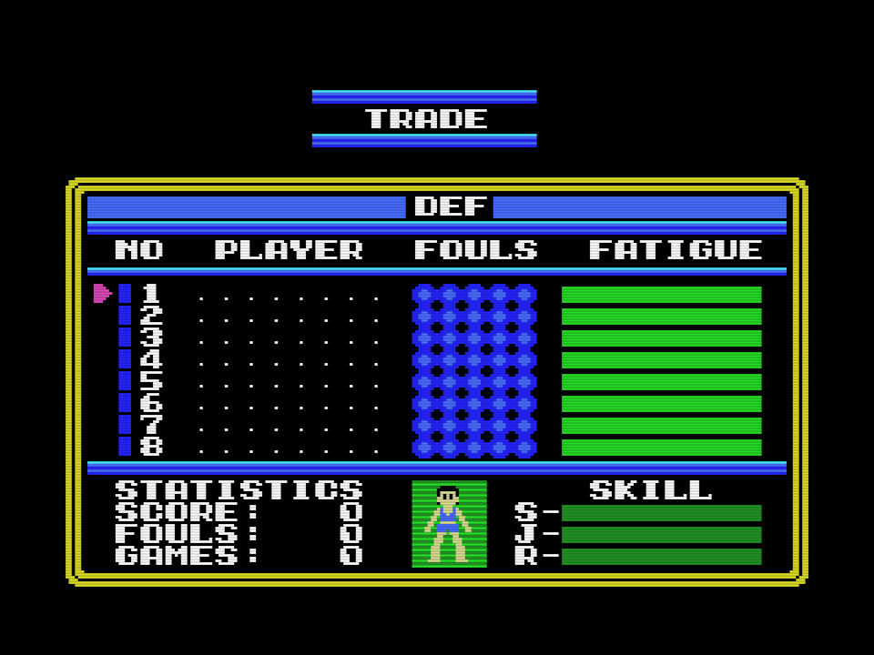

# El parche

`parche/dunkshot_msx2.ips`: 292 bytes, 164 bytes del cartucho cambiados en 24
tramos. En un MSX2 pone el juego en SCREEN 4, ocho sprites por línea, y enseña
solo la tabla ordenada por profundidad ([El parpadeo](EL-PARPADEO.md)). En un
MSX1 el mismo fichero se juega como el original.

## Lo que cambia el V9938

SCREEN 4 (modo G3) es SCREEN 2 con los sprites en modo 2: mismas tablas de
patrones, nombres y colores, así que los gráficos del juego no se tocan.
Cambian tres cosas:

- El registro 0 lleva el bit 2 (M4) en vez del bit 1 (M3). El TMS9918 no
  tiene M4, así que en un MSX1 no hay que tocarlo.
- El registro 5, con los bits 0-2 a 1 (el VDP los ignora), señala un bloque
  de 1 KB: su primera mitad es la tabla de colores de sprite, 16 bytes por
  sprite, un color por línea (bit 7 = early clock, como en el atributo), y
  los 128 bytes de atributos van en +0x200. El byte de color del atributo se
  ignora. Es lo que hace la BIOS en SCREEN 4: R5 = 0x3F, colores en 0x1C00,
  atributos en 0x1E00.
- El fin de la lista es Y = 216, no 208.

Bajo los 16 KB de un MSX1 el juego solo deja sin usar 0x3C00-0x3FFF (los
patrones de sprite acaban en 0x3BBF), así que: colores en 0x3C00-0x3DFF,
atributos en 0x3E00, y la segunda tabla que el MSX1 alterna en 0x3F00. En un
MSX1, R5 = 0x7C o 0x7E señala esas dos tablas; en un MSX2, R5 vale siempre
0x7F y el VDP enseña 0x3E00 los dos cuadros, la lista ordenada por profundidad
de 0xE7B0, de la que salen los colores. No se mueve ningún patrón.

## Lo que cambia en el cartucho

- `0x5036`: el `jp INIGRP` va a un gancho en el relleno a 0xFF de `0xBFD4`:
  tras INIGRP, ATRBAS = 0x3E00 y R5 = 0x7C; si la BIOS es de MSX2 (byte
  0x002D), además R0 = 4 y R5 = 0x7F.
- `0x5B7B`: el `xor 4` pasa a `xor 1`: la alternancia es 0x3E00 / 0x3F00.
  Su WRTVDP (`0x5B82`) pasa por `0xBFF3`, que en un MSX2 escribe siempre
  0x7F. `0x5B9B` compara con 0x3E, la tabla que `congela_sprites` deja a la
  vista.
- `0x5BE6`, `0x5BF2`: las dos copias por cuadro van a 0x3E00 y 0x3F00; la
  segunda sigue en `0x7AAE` con la tabla de colores: los 32 colores de la
  lista ordenada de 0xE7B0, 16 bytes cada uno, a 0x3C00 con `out` y sin
  interrupciones (`0x6EA0`). En un MSX1 vuelve sin hacer nada.
- `0x5BFB`, `0x7374`, `0x8057`: los fines de lista escriben 0xD0 y, en la
  entrada siguiente, 0xD8 (`0x6EC9`).
- `0x5063`, `0x804C`, `0x80D5`, `0x80DC`: 0x1B00 y 0x1B10 pasan a 0x3E00 y
  0x3E10.
- `0x80CE`: el final de `viste_jugador`, la figura de muestra de las fichas
  de equipo y de TRADE, salta a `0x6F30`: relee los ocho atributos de la
  VRAM y rellena sus colores, para que la figura conserve piel, pelo y
  camiseta también en un MSX2.

## Dónde vive el código nuevo

En el relleno a 0xFF de 0xBFD4-0xBFFD y en tres rutinas huérfanas del cartucho
que no llama nadie (0x6EA0, 0x6F30, 0x7AAE), encontradas al trazar el
desensamblado. Su listado es `parche/parche_msx2.asm`; el código original de
alrededor de cada byte parcheado está en `src/dunkshot.asm`.

| trozo | dirección | bytes |
|---|---|---|
| gancho tras INIGRP | 0xBFD4 | 31 |
| registro 5 según la máquina | 0xBFF3 | 11 |
| tabla de colores de sprite | 0x6EA0 | 38 |
| fin de lista, 0xD0 y 0xD8 | 0x6EC9 | 14 |
| colores de la figura de muestra | 0x6F30 | 22 |
| segunda copia y colores | 0x7AAE | 9 |
